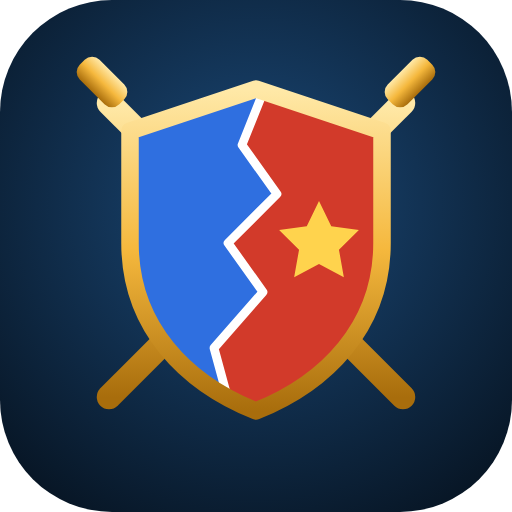

# Iron Atlas — Conquest of Europe

A real-time grand-strategy war game played on satellite imagery of Europe.
Download: [`downloads/IronAtlas.apk`](../downloads/IronAtlas.apk) (Android 5.0+).



## Gameplay
Everything is done by **drawing on the map with your finger**:
- **Create your own nation**: pick a name, color and emblem, then draw your borders anywhere on
  Europe. The land inside your loops becomes your country (undo supported). Or **play as** one of 45 countries.
- **Invade by drawing**: tap ✏️ *Draw* and circle any area — it doesn't have to touch your border.
  Tick which of the countries inside you want to attack, choose how many troops to commit and launch.
  If the circle isn't next to your land, your army fights a corridor there from your nearest border.
- **Alliances**: propose alliances in Diplomacy (or by tapping a country). Allies are called to arms when
  one of them is attacked, and may join each other's wars. The *Alliances* tab lists every alliance
  bloc and who has a pact with whom. AI countries form their own alliances against strong neighbours.
- **Sandbox** scenario: drawn loops become yours instantly — paint the map however you like.
- **Encirclement**: land cut off from its mainland during a war (not natural exclaves or islands) is
  lost after 7 in-game days — annexed by the enemy around it, or split between several enemies.
  A ⏳ countdown shows on the map; reconnect it in time to save it. Tiny leftover slivers vanish at once.
- **Peace treaties you draw**: in Diplomacy tap 📜 Peace, choose "France gets" / "Germany gets" and draw
  loops to redraw the border between you. The enemy shows live whether it will accept, based on how the
  war went (battles won, army sizes, captured capital).
- Land earns 💰 gold for troops. Capitals ★ are defended harder; take one after a country has lost half
  its land and it surrenders. 45 AI nations draw their own offensives. Control 70% of Europe to win.
- Scenarios: *Present day (2026)*, *Peaceful Europe*, *Sandbox*. AI aggression: Calm / Normal / Chaos.
- Pinch with two fingers to zoom (also while drawing). Auto-saves; continue from the title screen.

## Map data
- Satellite imagery: Esri World Imagery (needs internet; the game still works offline on a plain map).
  Google Maps/Earth tiles can't be used: Google's terms forbid loading their tiles outside their own SDKs.
- Borders: Natural Earth 1:50m (via `world-atlas`), rasterized by `tools/build-data.js` into a
  1600×1446 Web-Mercator grid that the game repaints as territory changes hands.

## Building
```bash
# 1. (optional) regenerate the territory grid
cd tools && npm install && node build-data.js && cd ..
# 2. build the APK (Ubuntu: apt install android-sdk-build-tools android-sdk-platform-23 apksigner zipalign)
./build-apk.sh            # writes ../downloads/IronAtlas.apk
```
Bump `VERSION_CODE=5 VERSION_NAME=1.4.0 ./build-apk.sh` for updates. Updates must be signed with
`android/ironatlas.keystore` (password `ironatlas`) or Android won't install them over the old version.

To try it in a browser, open `www/index.html`.
